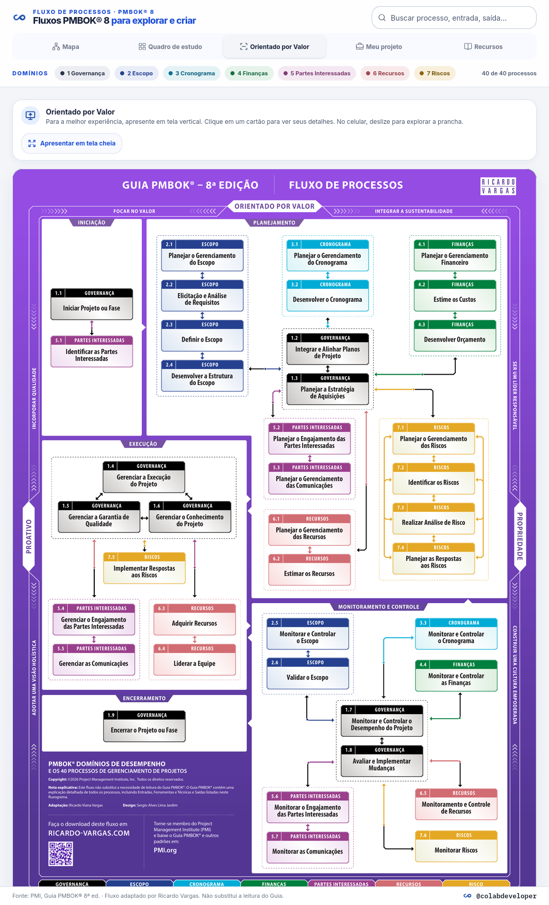

# Fluxo PMBOK 8 interativo · @colabdeveloper

Uma ferramenta educacional para explorar os 40 processos do Guia PMBOK® 8, estudar suas relações e criar fluxos próprios.

[](https://nextjs.org/)
[](https://react.dev/)
[](https://www.typescriptlang.org/)
[](LICENSE)

<p align="center">
  
</p>

<p align="center"><sub>Visão Orientado por Valor — a prancha pode ser explorada pelos cartões clicáveis e apresentada em tela cheia.</sub></p>

## Funcionalidades

- **Mapa** (React Flow): áreas suaves por fase, cores por domínio, zoom, pan e minimapa. Mostra inicialmente os 38 conectores explícitos do A0 e oferece as 203 conexões inferidas pelas entradas e saídas como outra visualização.
- **Quadro de estudo** (dnd-kit): cartões e fases têm rolagem própria no desktop; no celular, cada cartão também tem um seletor de fase. A tentativa é salva automaticamente neste navegador e pode ser retomada após recarregar. Use Verificar, Mostrar resposta ou Nova tentativa.
- **Meu projeto**: crie vários projetos, cada um com um fluxo próprio de etapas nomeadas, cartões com notas e conexões direcionais opcionais. Cartões do catálogo entram como cópias editáveis. O conteúdo é salvo localmente e pode ser exportado/importado em JSON; não há conta nem sincronização.
- **Orientado por Valor**: prancha vertical derivada do A3 simplificado, com os 40 cartões clicáveis, painel de detalhes que preserva a tela cheia e filtros de domínio na legenda inferior. No celular, a prancha pode ser explorada por rolagem horizontal.
- **Recursos**: links para consultar o PMBOK® 8 no PMI, encontrar informações da edição em português, acessar cursos gratuitos e explorar os materiais de Ricardo Vargas.
- **Painel lateral**: entradas, ferramentas e técnicas, saídas, e links das conexões inferidas para os processos de quem recebe e a quem alimenta.
- **Filtros**: por domínio e busca (também procura dentro de entradas e saídas).

## Links úteis

- [Fluxo PMBOK® 8 de Ricardo Vargas](https://get.ricardo-vargas.com/pmbok8en) · [Vídeo explicativo](https://youtu.be/TZMum9cuoJY)
- [PMBOK® no site do PMI](https://www.pmi.org/standards/pmbok) · [Introdução gratuita ao PMI-CPMAI™](https://www.pmi.org/shop/brazil/p-/elearning/free-introduction-to-cognitive-project-management-in-ai-cpmai/el185)

## Executar localmente a partir do GitHub
1. Instale o Git e o Node.js 20 LTS ou mais recente.
2. No repositório do GitHub, clique em **Code**, copie a URL HTTPS e rode em um terminal:
   ```
   git clone <URL HTTPS copiada do GitHub>
   cd pmbok-flow-app
   npm install
   npm run dev
   ```
3. Abra http://localhost:3100

Outros scripts: `npm run build`, `npm run lint`, `npm run typecheck`.

## Estrutura
- `data/processes.json`: princípios, domínios, fases, 40 processos (com entradas, ferramentas, saídas, `flags` e notas de normalização), `a0Connectors` e `edges`.
- `lib/data/ProcessRepository.ts`: interface para o conteúdo de referência do fluxo. `JsonProcessRepository.ts` é a implementação atual, e `index.ts` escolhe o adapter. `lib/projects/` separa o modelo versionado dos projetos e sua persistência local para permitir outro adaptador no futuro.
- `components/flow/`: `FlowApp`, `MapView`, `BoardView`, `ValueView`, `MyProjectsView`, `ResourcesView` e `ProcessSheet`. `components/ui/`: componentes compartilhados do shadcn/ui, incluindo confirmações acessíveis no padrão visual do app.
- `public/orientado-por-valor.png`: renderização em alta resolução da prancha A3 original para manter a composição, as setas e a tipografia da fonte na apresentação vertical.
- `scripts/`: utilitários de manutenção do dataset. Consulte [Manutenção dos dados do A0](docs/data-maintenance.md) somente se precisar atualizar os dados a partir do PDF-fonte.

## Sobre as conexões
Os `a0Connectors` registram os 38 conectores desenhados explicitamente entre cartões no PDF A0; suas setas têm pontas nos dois sentidos. As 203 `edges` são relações dirigidas inferidas quando uma saída nomeada do processo A aparece como entrada do processo B. Elas são uma camada de estudo baseada em correspondência de nomes, não uma transcrição do encadeamento oficial do PMI nem uma confirmação de causalidade entre processos.

Para evitar uma teia de linhas, a geração dessas conexões inferidas ignora itens amplos ou recorrentes: fatores ambientais da organização (FAO), ativos de processos da organização (APO), "Etc.", "Plano de gerenciamento do projeto", "Documentos do projeto" e atualizações. **Esse filtro afeta somente as linhas inferidas:** não remove entradas ou saídas dos cartões, não altera os conectores explícitos do A0 e não afirma que os itens ignorados sejam irrelevantes. Por isso, a ausência de uma linha inferida não significa que dois processos não tenham relação; significa apenas que não foi criada uma ligação a partir dos nomes selecionados por essa regra. O painel lateral mantém as relações inferidas e os cartões continuam exibindo suas listas completas de entradas e saídas.

Os nomes dos cartões 4.2 e 6.5 e a saída EAP do cartão 2.4 foram normalizados. A redação literal do A0 está preservada em `sourceNotes` no JSON, fora dos avisos apresentados ao usuário. A extração reaplica essas normalizações e as notas em cada execução.

A prancha A3 em **Orientado por Valor** preserva a arte original, incluindo a redação literal de 4.2 e 6.5. Ao abrir os cartões, o painel apresenta os nomes normalizados e os detalhes. O restante da interface segue os tokens de cor, tipografia e superfícies do design system do projeto.

Fonte: PMI, Guia PMBOK® 8ª ed. Fluxo adaptado por Ricardo Vargas. Este app não substitui a leitura do Guia.

## Licença

O código original deste projeto é disponibilizado sob a licença MIT. As pranchas, dados e imagens de terceiros permanecem sujeitos aos direitos e às condições de seus titulares e não são licenciados pela MIT. Consulte [Conteúdo e materiais de terceiros](THIRD_PARTY_NOTICES.md) para os créditos e o escopo detalhado.
